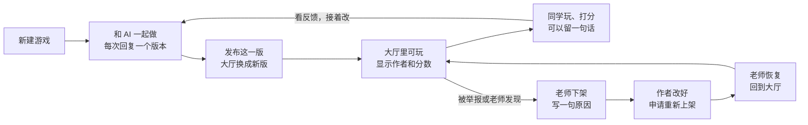

# 游戏板块设计

2026-11-26

在线版（可评论）：https://claude.ai/artifact/BoaCnpVySLPeNrvinPTmEt

## 定位

“游戏”是平台上一个独立板块：学生和 AI 对话做自己想做、想玩的游戏，发布给同学玩，再根据反馈反复改。它只是一个开发和游玩的场所，不布置任务、不考核、不进成绩册。

老师在这里只做管理：下架不合适的游戏、删除不友善的留言。

## 已定的决定

| 事项 | 决定 | 理由 |
| --- | --- | --- |
| 引擎 | Phaser 4（写文档时为 4.2.1），带简单物理的版本 | 2D 游戏引擎里最流行，AI 最熟悉，仍在更新；KAPLAY 正式版停在 2025-06 |
| 画风 | 像素风 | AI 画的、学生画的和素材库能混用；文件小 |
| Emoji | 第一版不做 | 机房有 Win7，显示不了彩色 emoji；也和像素风不搭 |
| 板块 | 独立的“游戏”板块，不挂在挑战或创作下面 | 用户决定；内部尽量复用工作台和版本 |
| 做什么 | 学生自由创作，可以反复迭代，没有老师出的题 | 定位是场所，不是课堂任务 |
| 发布 | 只有“发布”，没有“交这一版”，不进成绩册 | 不考核 |
| 反馈 | 1～5 星加一句话，显示作者 | 反馈是给作者改游戏用的 |
| 管理 | 所有老师都能下架、恢复、删留言；学生可以举报 | 老师不可能每个游戏都玩 |
| AI 风格 | 保留“做了什么”“我替你定的”，“想一想”不必每次都问 | 自由场所里不必每次都追问 |
| 联机 | 第二期 | 先把单人游戏的整套跑通；第二期先只做轮流类 |

## 页面

顶栏加一个“游戏”入口，和教程、挑战并列。板块里有三个页面：

- **游戏大厅**：类似 Steam 的商店式首页（见“游戏市场与奖励”），每个游戏显示封面、名字、作者、最新版分数、游玩次数。封面是静态图片，不在列表里直接运行游戏
- **游戏页**：大预览里玩游戏，下面是分数和留言，还有“举报”按钮
- **我的游戏**：自己做的游戏列表，点开进入工作台（左边 AI 对话，右边预览和代码，下面是版本条）；工作台里有“发布这一版”，也能看到玩家的分数和留言；被下架的游戏在这里显示下架原因

工作台复用现在挑战和创作用的 `Workbench.vue`，只是预览里多加载 Phaser 和素材，AI 换成游戏版提示词。

## 一个游戏的生命周期



主循环是：学生和 AI 做出一版，发布到大厅，看同学的分数和留言再接着改，一个游戏可以做几周。下架回路里，只有老师恢复才回到大厅；下架期间发新版不会自动上架。

## 引擎与运行环境

游戏仍然是一个网页（HTML / CSS / JS 三栏），只是预览里提前加载好 Phaser 4 和我们的辅助代码。

- **注入方式**：所有预览都由 `client/src/utils/previewDocument.ts` 的 `buildPreviewDocument` 生成，在这里为游戏加上引擎、素材和辅助代码。预览里现在屏蔽外链，要放行自己服务器上的这几个文件
- **引擎文件**：用 `phaser-arcade-physics.min.js`，约 1.27 MB，压缩传输约 355 KB。版本固定，放在自己服务器上，机房离线也能用
- **浏览器**：机房是 Chrome 105，Win7 和 Win10/11 都有。扫过代码，没发现 Chrome 105 不支持的写法，不另在 Win7 上专门测试
- **渲染**：默认 WebGL。Phaser 4 还保留了 Canvas 渲染（官方标为不推荐），WebGL 用不了的老机器会退回 Canvas，部分新特效不可用
- **点击开始**：游戏开头统一显示“点击开始”，让预览拿到键盘焦点，也满足浏览器“先点击才能播声音”的要求
- **封面**：辅助代码在游戏开始后自动截一张画面当封面，学生也可以自己换一张。大厅只显示封面，避免一页同时加载几十份 1 MB 的引擎

已实现（`client/public/game/`，由 `buildPreviewDocument({ game: true })` 注入）：`vendor/` 里是 Phaser 4.2.1 和 ZzFX 1.4.0；`assets.js` 由 `client/scripts/game-assets.ts` 根据 `assets.json` 生成，图集以 base64 内嵌（预览是沙箱 iframe，和网站不同源，从网站加载的图片画进 WebGL 会被浏览器拦下）；`runtime.js` 是辅助代码：

- 点了“点击开始”才启动游戏；开始后 3 秒截封面，外层也能随时要一张；消息都用 `postMessage`（`source: "wp-game"`）
- 报错、Phaser 打在控制台的警告、贴图名写错（Phaser 不报错，只显示缺图方块）都传给外层，同样的只报一次
- 内置素材按名字取用时才创建，AI 自己画了同名贴图（`wall`、`coin` 很常见）就用它自己的；多帧素材有同名动画
- 兼容 Phaser 3 写法：`group.children.iterate / each`、`this.textures.generate`（像素画）、`setTintFill`（Phaser 4 留了一个只报错的空壳，要覆盖）、`Math.PI2`
- 默认 `pixelArt: true`，画面按比例缩放到预览大小并居中

小测试里 DeepSeek 生成的 20 个版本，接上辅助代码后全部能玩（原来提示词 A 只有 5/10、B 有 8/10）。学生上传的图片在 `/media`，游戏里要用的话 Caddy 得给 `/media` 加 CORS 头，否则同样会被拦。

## 素材

AI 只写代码、产不出图片和声音，所以素材有三个来源，都是像素风。

| 来源 | 做法 | 备注 |
| --- | --- | --- |
| 内置素材库 | 挑几十到一两百个 Kenney 像素素材（CC0），按角色、敌人、物品、地块、背景分类，起好懂的名字（如 `player-blue`、`coin`）；提示词里附素材清单，AI 按名字引用 | 候选：[Pixel Platformer](https://kenney.nl/assets/pixel-platformer)、[Tiny Dungeon](https://kenney.nl/assets/tiny-dungeon)、[Pixel Shmup](https://kenney.nl/assets/pixel-shmup)；清单越长越费 token |
| AI 画像素画 | AI 写一个由字符组成的网格，每个字符是一种颜色，由我们注入的辅助函数转成图片 | Phaser 3 自带的 `textures.generate` 在 Phaser 4 里已删除，所以要自己写，并在提示词里告诉 AI |
| 学生上传 | 用平台现有的图片上传 | 以后可加像素编辑器，参考 MakeCode Arcade |

已选定 125 个素材和 3 张 800×600 整张背景，来自 5 个包（另加了 Pixel Platformer Food Expansion，里面也没有苹果，苹果让 AI 用像素画辅助函数画），放在 `client/public/game/`：`assets.json` 是清单，`sheets/` 是 8 张图集（共约 30 KB），`preview.html` 显示全部素材。命名约定：`enemy-*` 是侧视角和射击游戏的敌人，`monster-*` 是俯视角的怪物，`floor-*` 是俯视角铺满用的地面。素材只有 16～32 像素，游戏里要放大（如 `setScale(3)`）并开 `pixelArt: true`。

**音效**：第一版只用 ZzFX（不到 1 KB，MIT，用一串参数现场合成跳跃、得分、爆炸等复古音效），不打包音效文件，也不做背景音乐；Kenney 音效包以后再考虑。

不做：emoji（第一版）、AI 生图（透明背景、风格统一、费用、审核都是问题）。

## AI 对话

游戏用一套单独的提示词，风格比挑战里的“教练”轻一些。

- **回复格式**：保留“做了什么”和“我替你定的”。后者对游戏特别有用，学生知道速度、重力、生命数、规则是 AI 替他定的，才会想到去改。“想一想”只在有值得问的事时才写，不必每次都问
- **没有题目清单**：自由创作，不加挑战里的 `BRIEF_RULES`
- **Phaser 4 写法**：提示词里写明版本和要点，防止 AI 混用 Phaser 3 的写法（如已删除的 `textures.generate`）。具体写哪些要等小测试的结果
- **辅助代码**：告诉 AI 素材清单、像素画辅助函数、音效怎么用，以及“点击开始”和封面由平台负责，不用它自己做
- **引导游戏类型**：不限制做什么，但可以在学生没想法时提几类容易做好的：接东西、躲避、跳跃、射击、迷宫

已实现：`services/llm.ts` 的 `GAME_SYSTEM_PROMPT`（拼上素材清单约 4500 字），`ws.ts` 在 `task_type = 'game'` 时使用。素材清单 `services/gameAssets.ts` 和 `assets.js` 一起由 `client/scripts/game-assets.ts` 生成，单元测试检查它和 `assets.json` 一致。

验证（2026-11-26，DeepSeek）：5 个游戏（接苹果、跳平台、打飞机、迷宫、地牢）共 12 个版本，再加 10 个第一轮重跑，全部能玩、没有报错和警告。每个游戏都用了 3～12 个内置素材，苹果用 `textures.generate` 画，都加了 ZzFX 音效，没有出现 Phaser 3 写法，也没有自己再做“点击开始”。没有格式示例时 2/12 的第一轮回复没按“做了什么 / 我替你定的”写，加了示例后 10/10 都按格式。

## 玩家反馈与评分

反馈是给作者改游戏用的，不是成绩。

- **打分**：1～5 星，按发布的版本分别计；大厅显示最新版的分数。作者能看到各版本的分数变化，改好了不会被旧版本的低分拖累
- **满 3 人才显示**：大厅显示“★4.2（12 人）”，不到 3 人显示“还在收集评分”；作者始终能看到全部打分和留言
- **每人每版一次**：每人每个版本只能打一次分，可以改；作者不能给自己打分
- **一句话**：可选，比如“跳得太低，过不去第二关”，作者可以直接拿去跟 AI 说
- **谁能看到谁**：留言显示名字；星级对作者匿名，避免报复性打分；老师能看到所有打分人
- **显示作者**：发布的是作品，不像互评那样打分前匿名
- **热度**：大厅显示游玩次数
- **不复用现有评分算法**：`services/score.ts` 按老师 / 学生权重加贝叶斯平滑算成绩，游戏不需要这些，用简单平均即可

## 版本记录

学生的每一步都留记录，发布的版本单独存快照。

- **每一步**：沿用工作台现有的记录（`messages` 表）。AI 每次回复、手改、粘贴的代码都是一个版本，学生说的每句话带 L1～L6 分级，版本条能回到任一旧版本
- **每次发布**：存一份快照，编号“第 1 版”“第 2 版”……；评分和留言挂在具体版本上，已发布的版本不再改变
- **更新说明**：发布时选填“这一版改了什么”。AI 根据上次发布以来各次回复里的“做了什么”起草，学生可以直接用或改
- **版本历史**：游戏页列出历代版本，带更新说明和分数。玩家只能玩最新版，作者能玩所有旧版，避免下架恢复后旧版里的问题内容又露出来
- **成长回放**：复用 `ChainModal.vue`，按发布版本分段，从第一版翻到最新版。默认只有作者和老师能看，作者可以选择公开给同学
- **老师看过程**：老师能看任何学生的对话和版本，和挑战一样

存储：每版存完整代码，粗算每版 10～20 KB，200 人各 100 版约几百 MB。需要时可以只保留发布版和最近若干版。

## 游戏市场与奖励

大厅做成类似 Steam 的商店。奖励第一版只做荣誉类（徽章、榜单、老师推荐），不做虚拟币，不进成绩；现实奖励由老师线下决定。

- **首页分几排**：老师推荐、热门、新上架、最近更新、好评、随机推荐。“新上架”和“随机推荐”让新游戏和冷门游戏也有曝光，避免强者恒强
- **标签**：作者发布时选标签（跳跃、射击、迷宫、益智……），大厅可以按标签筛选
- **榜单**：全校一个榜，分周榜和月榜
- **老师推荐**：老师手动把游戏放到首页推荐位
- **作者徽章**：按规则自动发的，如“百人玩过”“好评如潮”“进步之星”（某一版比上一版分数提高最多）；老师颁发的，如“最有创意”“最佳更新”。徽章要多样，让不同的学生都有机会拿到
- **玩家徽章**：其他玩家可以给留言点“有用”，留言常被点有用的学生得“金牌评测员”，鼓励认真给反馈
- **防刷**：游玩次数只算不同的人；玩超过 30 秒才算一次游玩；只有玩过的人能打分；星级对老师实名，老师能看出互刷

待定：各徽章的门槛、“热门”和榜单的排序规则。虚拟币（赚金币换头像框、素材）以后再考虑。

## 老师管理

所有老师（admin 和 super）都能管所有游戏，不按班级分。

- **下架**：要写一句原因。游戏从大厅消失，同学找不到、也玩不了；作者在“我的游戏”里看到“已被老师下架：原因”
- **重新上架**：只能由老师恢复。作者改好后点“申请重新上架”，老师看过再恢复；下架期间作者自己发布新版不会自动上架
- **删留言**：删掉不友善的话
- **举报**：学生在游戏页点“举报”并写原因，老师那边看到待处理的举报列表；举报只提醒老师，不会自动下架
- **操作记录**：每次下架、恢复、删留言都记下是谁、什么时候、为什么

**管理入口**有两处：老师在大厅和游戏页里直接下架、删留言；教学侧栏加一个“游戏管理”页，分待处理的举报、已下架和申请重新上架的游戏、操作记录三栏，有新举报或新申请时侧栏显示数字提醒。

## 联机（第二期）

联机能做，建议等单人游戏的整套跑通后再做；第一期设计时给它留好位置。第二期先只做轮流类，跑稳了再考虑实时对战。

- **服务器只转发**：后端加一个房间 WebSocket，把一个玩家的消息转给同房间的其他人，不跑游戏逻辑
- **学生代码不直连服务器**：预览里的游戏通过 postMessage 交给外层页面转发，拿不到登录凭证；注入一个联机辅助函数（加入房间、发消息、收消息）给 AI 用
- **先只做轮流类**：五子棋、井字棋、猜拳、抢答最稳；实时对战等轮流类跑稳了再考虑，机房经学校服务器转发的延迟也要实测
- **双人预览**：工作台左右两个预览各当一个玩家，学生一个人就能测
- **打分**：用“双人试玩”，打分的人在左右两个窗口里分别操作两方，不强制游戏带单人或人机模式
- **对手显示名字**：同一个机房里找同学一起玩，匿名没有意义；平台不提供聊天
- **限制**：房间人数、每秒消息数、消息大小都要设上限（后端是单进程）

## 小测试结果

提示词里必须写 Phaser 4 写法说明：不写时 10 个版本只有 5 个能玩，写了有 8 个。

2026-11-26 用 DeepSeek（deepseek-flash，开思考）按学生的说法做了 4 个游戏（接苹果、跳平台、打飞机、迷宫），每个 2～3 轮，共 10 个版本；两种提示词各跑一遍，在 Chrome 里点击、按键试玩。

| 提示词 | 能玩的版本 | 坏掉的原因 |
| --- | --- | --- |
| A：只说用 Phaser 4 | 5 / 10 | 跳平台、打飞机的每一版都用了 Phaser 3 的 `group.children.iterate` / `.each`；Phaser 4 里 `children` 是原生 Set，没有这两个方法，游戏一开始就报错 |
| B：加 Phaser 4 写法说明 | 8 / 10 | 跳平台第 2、3 版少写了结尾的 `</script>`，整段脚本不运行，页面空白且没有报错 |

- 能跑的游戏画面完整、能操作，计分、生命、游戏结束、重来、计时都按要求做出来了
- 代码每版 6～15 KB，和存储估算一致；第一轮回复 40～70 秒，之后多为 12～20 秒
- 没发现 Chrome 105 不支持的写法

由此要做的：

- 提示词的 Phaser 4 说明里加上：`group.children` 是原生 Set，遍历用 `group.getChildren()`（B 这次没踩到只是运气）
- 注入一个兼容补丁，给 `group.children` 补上 `iterate` / `each`，AI 忘了也不会坏
- 拆代码时容忍没闭合的 `<script>`：现在服务器 `services/llm.ts` 和前端 `utils/code.ts` 的正则都要求有 `</script>`，对现有挑战也是隐患
- 预览把运行报错传给外层页面，学生点一下就能把报错发给 AI 修；学生不看代码，AI 自己修错是关键

## 数据库与接口

游戏本身沿用自由创作的做法：`tasks` 里 `task_type = 'game'` 的一行，`owner_id` 是作者，`html / css / js` 是工作台里的当前代码，`display` 是网址序号（`/game/:display`）。这样 AI 对话、版本条、手改和粘贴（`conversations` / `messages`）、工作台全都直接复用。发布、评分、举报这些游戏特有的东西放新表，不碰 `submissions` / `ratings`，成绩册、批改墙、评分算法都不受影响。

也考虑过把游戏本体单独放一张表：对话表 `conversations.task_id` 是 NOT NULL 且指向 `tasks`，那样要么重建对话表、迁移生产库，要么复制一整套对话代码，所以不采用。

只新增表、不改旧表，所以不用升 `SCHEMA_VERSION`。

### 新表

```sql
-- 游戏的额外信息，和 tasks 一对一（不往 tasks 加列，免得改旧表）
CREATE TABLE IF NOT EXISTS games (
  task_id INTEGER PRIMARY KEY REFERENCES tasks (id) ON DELETE CASCADE,
  -- draft（没发布过）/ listed（在大厅）/ taken_down（被老师下架）
  status TEXT NOT NULL DEFAULT 'draft',
  latest_version INTEGER NOT NULL DEFAULT 0,
  first_published TEXT,
  last_published TEXT,
  -- 大厅列表要的统计，写评分 / 游玩时顺手更新，列表不用现算
  play_count INTEGER NOT NULL DEFAULT 0,
  rating_sum INTEGER NOT NULL DEFAULT 0,      -- 最新版的
  rating_count INTEGER NOT NULL DEFAULT 0,
  featured_at TEXT,                           -- 老师推荐；NULL = 没推荐
  replay_public INTEGER NOT NULL DEFAULT 0,   -- 成长回放公开给同学
  takedown_reason TEXT,
  appeal_at TEXT,                             -- 作者申请重新上架的时间
  cover TEXT                                  -- media/ 下的封面路径
);
CREATE INDEX IF NOT EXISTS games_status ON games (status, last_published);
CREATE INDEX IF NOT EXISTS games_featured ON games (featured_at) WHERE featured_at IS NOT NULL;

CREATE TABLE IF NOT EXISTS game_tags (
  task_id INTEGER NOT NULL REFERENCES tasks (id) ON DELETE CASCADE,
  tag TEXT NOT NULL,
  PRIMARY KEY (task_id, tag)
);
CREATE INDEX IF NOT EXISTS game_tags_tag ON game_tags (tag, task_id);

-- 每次发布一行；代码另放一张表，列表扫这张表时不读代码
CREATE TABLE IF NOT EXISTS game_releases (
  id INTEGER PRIMARY KEY AUTOINCREMENT,
  task_id INTEGER NOT NULL REFERENCES tasks (id) ON DELETE CASCADE,
  version INTEGER NOT NULL,
  -- 发布的是哪条 AI 回复；那条消息被删了也不影响已发布的代码
  message_id INTEGER REFERENCES messages (id) ON DELETE SET NULL,
  rating_sum INTEGER NOT NULL DEFAULT 0,
  rating_count INTEGER NOT NULL DEFAULT 0,
  created TEXT NOT NULL,
  notes TEXT NOT NULL DEFAULT '',             -- 更新说明
  UNIQUE (task_id, version)
);
CREATE INDEX IF NOT EXISTS game_releases_message ON game_releases (message_id) WHERE message_id IS NOT NULL;
CREATE TABLE IF NOT EXISTS game_release_code (
  release_id INTEGER PRIMARY KEY REFERENCES game_releases (id) ON DELETE CASCADE,
  html TEXT, css TEXT, js TEXT
);

-- 玩过的人：玩满 30 秒记一次，每人每个游戏一行；周榜 / 月榜按 first_played 算新增玩家
CREATE TABLE IF NOT EXISTS game_plays (
  task_id INTEGER NOT NULL REFERENCES tasks (id) ON DELETE CASCADE,
  user_id INTEGER NOT NULL REFERENCES users (id) ON DELETE CASCADE,
  first_played TEXT NOT NULL,
  last_played TEXT NOT NULL,
  PRIMARY KEY (task_id, user_id)
);
CREATE INDEX IF NOT EXISTS game_plays_user ON game_plays (user_id);
CREATE INDEX IF NOT EXISTS game_plays_first ON game_plays (first_played, task_id);

-- 打分和一句话；每人每版一条，可以改。老师删留言只清 comment，星级保留
CREATE TABLE IF NOT EXISTS game_ratings (
  id INTEGER PRIMARY KEY AUTOINCREMENT,
  release_id INTEGER NOT NULL REFERENCES game_releases (id) ON DELETE CASCADE,
  user_id INTEGER NOT NULL REFERENCES users (id) ON DELETE CASCADE,
  stars INTEGER NOT NULL,
  helpful_count INTEGER NOT NULL DEFAULT 0,
  created TEXT NOT NULL,
  modified TEXT NOT NULL,
  comment TEXT,
  UNIQUE (user_id, release_id)
);
CREATE INDEX IF NOT EXISTS game_ratings_release ON game_ratings (release_id);
CREATE TABLE IF NOT EXISTS game_rating_helpful (
  rating_id INTEGER NOT NULL REFERENCES game_ratings (id) ON DELETE CASCADE,
  user_id INTEGER NOT NULL REFERENCES users (id) ON DELETE CASCADE,
  PRIMARY KEY (rating_id, user_id)
);
CREATE INDEX IF NOT EXISTS game_rating_helpful_user ON game_rating_helpful (user_id);

CREATE TABLE IF NOT EXISTS game_reports (
  id INTEGER PRIMARY KEY AUTOINCREMENT,
  task_id INTEGER NOT NULL REFERENCES tasks (id) ON DELETE CASCADE,
  user_id INTEGER NOT NULL REFERENCES users (id) ON DELETE CASCADE,
  reason TEXT NOT NULL,
  created TEXT NOT NULL,
  resolved_at TEXT,
  resolved_by INTEGER REFERENCES users (id) ON DELETE SET NULL
);
CREATE INDEX IF NOT EXISTS game_reports_task ON game_reports (task_id);
CREATE INDEX IF NOT EXISTS game_reports_user ON game_reports (user_id);
CREATE INDEX IF NOT EXISTS game_reports_resolver ON game_reports (resolved_by) WHERE resolved_by IS NOT NULL;
CREATE INDEX IF NOT EXISTS game_reports_pending ON game_reports (created) WHERE resolved_at IS NULL;

-- 徽章：自动发的 awarded_by 为 NULL；门槛待定
CREATE TABLE IF NOT EXISTS game_badges (
  id INTEGER PRIMARY KEY AUTOINCREMENT,
  user_id INTEGER NOT NULL REFERENCES users (id) ON DELETE CASCADE,
  task_id INTEGER REFERENCES tasks (id) ON DELETE CASCADE,   -- 玩家徽章没有游戏
  badge TEXT NOT NULL,
  awarded_by INTEGER REFERENCES users (id) ON DELETE SET NULL,
  created TEXT NOT NULL
);
CREATE INDEX IF NOT EXISTS game_badges_user ON game_badges (user_id);
CREATE INDEX IF NOT EXISTS game_badges_task ON game_badges (task_id) WHERE task_id IS NOT NULL;
CREATE INDEX IF NOT EXISTS game_badges_awarder ON game_badges (awarded_by) WHERE awarded_by IS NOT NULL;

-- 老师的操作记录。游戏删了记录要留着，所以 task_id 是 SET NULL，另存一份标题
CREATE TABLE IF NOT EXISTS game_log (
  id INTEGER PRIMARY KEY AUTOINCREMENT,
  task_id INTEGER REFERENCES tasks (id) ON DELETE SET NULL,
  actor_id INTEGER REFERENCES users (id) ON DELETE SET NULL,
  -- take_down / restore / delete_comment / feature / unfeature / award_badge / dismiss_report
  action TEXT NOT NULL,
  game_title TEXT NOT NULL,
  created TEXT NOT NULL,
  reason TEXT NOT NULL DEFAULT ''
);
CREATE INDEX IF NOT EXISTS game_log_task ON game_log (task_id) WHERE task_id IS NOT NULL;
CREATE INDEX IF NOT EXISTS game_log_actor ON game_log (actor_id) WHERE actor_id IS NOT NULL;
CREATE INDEX IF NOT EXISTS game_log_created ON game_log (created);
```

要点：

- 大厅列表只扫 `games`（小列），代码、留言都在别的表；热门、新上架、最近更新、好评都在 `games` 上排序
- 周榜 / 月榜 = 这段时间里新增的玩家数，走 `game_plays_first` 索引
- 游玩次数靠前端计时，玩满 30 秒才上报；服务器无法验证，课堂场景够用
- 留言列表只显示名字和留言，不显示每个人的星级；星级只出现在汇总分里，老师能看到每个人打了几星

### 接口（挂在 `/api/game`）

| 谁 | 接口 | 说明 |
| --- | --- | --- |
| 作者 | `GET /game/mine` | 我的游戏：状态、最新版本、分数、游玩人数 |
| 作者 | `POST /game` | 新建（标题） |
| 作者 | `PUT /game/:display`、`PUT /game/:display/code`、`DELETE /game/:display` | 改标题简介、存工作台代码、删除，同自由创作 |
| 作者 | `POST /game/:display/releases` | 发布：`message_id`（发布哪一版）、`notes`、`tags`；版本号自动 +1；被下架时发布不会自动上架 |
| 作者 | `POST /game/:display/notes-draft` | AI 根据上次发布以来的“做了什么”起草更新说明 |
| 作者 | `PUT /game/:display/cover` | 上传封面（预览自动截图，或学生自己换） |
| 作者 | `PUT /game/:display/replay` | 成长回放是否公开 |
| 作者 | `POST /game/:display/appeal` | 申请重新上架 |
| 所有人 | `GET /game/hall` | 大厅：`section` = featured / hot / new / updated / top / random，可按 `tag` 筛选，分页 |
| 所有人 | `GET /game/leaderboard` | 周榜 / 月榜 |
| 所有人 | `GET /game/:display` | 游戏页：最新版代码、作者、标签、分数、历代版本和更新说明 |
| 所有人 | `GET /game/:display/ratings` | 留言（分页） |
| 所有人 | `GET /game/:display/replay` | 成长回放（作者、老师；公开后所有人） |
| 玩家 | `POST /game/:display/play` | 玩满 30 秒时上报 |
| 玩家 | `PUT /game/:display/rating` | 给最新版打分、写一句话；要玩过，不能给自己打 |
| 玩家 | `POST /game/ratings/:id/helpful` | 点 / 取消“有用” |
| 玩家 | `POST /game/:display/report` | 举报 |
| 老师 | `POST /game/:display/takedown`、`/restore` | 下架（要原因）、恢复 |
| 老师 | `DELETE /game/ratings/:id/comment` | 删留言 |
| 老师 | `PUT /game/:display/featured`、`POST /game/:display/badges` | 推荐、颁发徽章 |
| 老师 | `GET /game/admin/reports`、`POST /game/admin/reports/:id/resolve` | 举报列表、处理 |
| 老师 | `GET /game/admin/log`、`GET /game/admin/summary` | 操作记录；侧栏数字提醒（待处理举报 + 申请数） |

实现时另加了：`GET /game/tags`（标签列表）、`GET /game/:display/workspace`（作者工作台的当前代码）、`GET /game/:display/releases/:version`（某一版的代码）、`GET /game/admin/takedowns`（被下架的游戏，申请重新上架的排前面）。固定标签：平台跳跃、射击、迷宫、躲避、接东西、跑酷、益智、冒险、双人、反应、其他，发布时选一到两个。徽章暂时只有老师颁发的“最有创意”“最佳更新”，自动徽章等门槛定了再加。代码在 `server/src/routes/game.ts`，测试在 `server/tests/game.test.ts`。

### 要改的现有代码

- `services/prompt.ts` 的 `canAccessTask`：游戏和自由创作一样，只有作者（和超管）能和 AI 对话
- 老师看过程：提示词记录的读取接口要放开给老师（admin + super）读游戏的对话，现在自由创作只有超管能看
- `ws.ts` / `services/llm.ts`：`task_type = 'game'` 时用游戏版提示词，附上素材清单
- `client/src/utils/previewDocument.ts`：游戏预览注入 Phaser、素材和辅助代码
- `services/cascade.ts`：删游戏走 `deleteTask`，新表都随 `tasks` 级联删除

## 待验证与下一步

第一期已全部完成（2026-11-26）：后端、预览辅助代码、游戏版提示词、前端页面——游戏大厅（`/game`）、我的游戏（`/game/mine`）、游戏页（`/game/:display`）、游戏工作台（`/game/:display/edit`）、老师的游戏管理（`/dashboard/games`，侧栏显示待处理数）。在浏览器里用临时数据库走过一遍：新建 → AI 生成 → 预览里玩 → 发布（AI 起草更新说明、自动封面）→ 同学玩满 30 秒、打分留言、举报 → 老师推荐、颁发徽章、下架 → 作者看到下架原因 → 恢复；报错条“发给 AI 修”、制作过程回放、深色模式也看过。

还没做的：

- [ ] 自动徽章（百人玩过、好评如潮、进步之星、金牌评测员）的门槛
- [ ] 学生上传的图片用在游戏里：Caddy 给 `/media` 加 CORS 头
- [ ] 联机（第二期）

数据库设计（游戏、发布版本、评分留言、举报、操作记录）和接口在测试之后再写。
